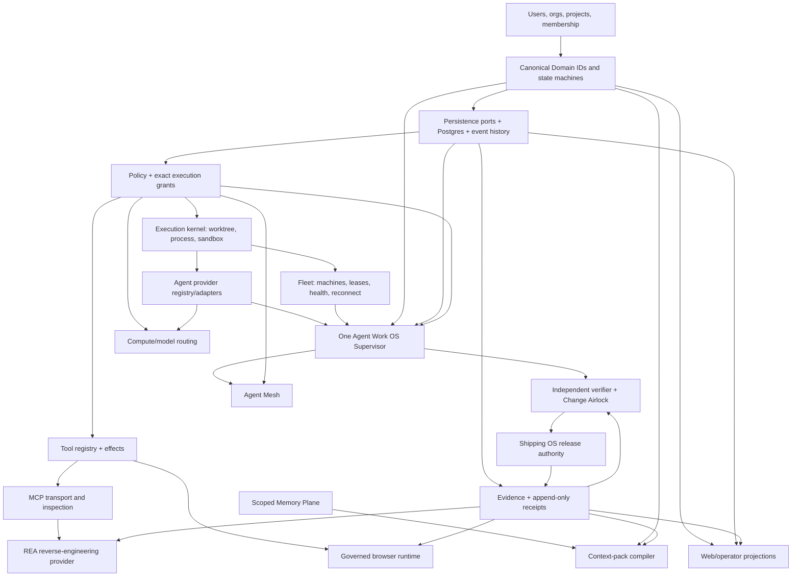

# Capability Dependency Graph

All arrows mean “depends on.” Agent Work OS is the only authority. Providers, clients and research systems do not own task, approval, policy, evidence or release truth.

## Build order

1. Domain + versioned persistence + restart/concurrency semantics.
2. Execution kernel (worktree ownership, process, cancellation, receipts).
3. Agent provider contract + durable session events.
4. One Supervisor, leases, retry/recovery and bounded repair.
5. Tool registry and exact grants; REA and MCP adapters.
6. Memory/context projections with tenant/project isolation.
7. Independent verifier, Change Airlock and Shipping OS binding.
8. Browser, Fleet UI, Mesh and Compute after their dependencies.

## Authority constraints

- Supervisor owns orchestration, not shipment certification.
- REA owns no canonical state or execution permission.
- Fleet reports worker/machine truth; disconnect does not imply task failure.
- Memory/context stores or projects knowledge, never approvals or task status.
- Provider registry availability is not authorization.
- UI is a projection; updates go through canonical APIs.
- Shipping OS emits `SHIPPED` only from exact-SHA deployment and verification evidence.
