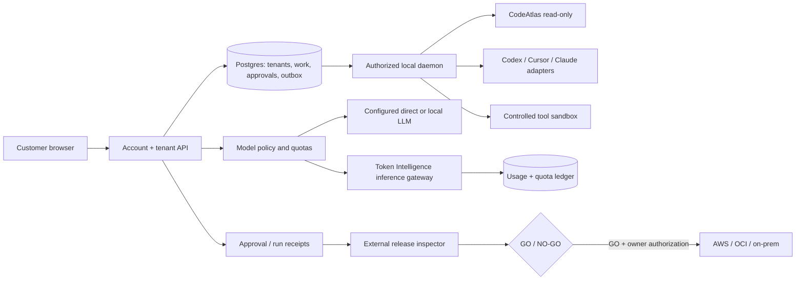

# Universal Agent OS — Launch REA / Roadmap / Four-Wave Shipping Contract
Date: 2026-10-28. Status: **SPECIFIED, conditional; production NO-GO**.
Owner: rrahul0904. Owned repos: `rrahul0904/agent-work-os` (main shipping product) and `rrahul0904/token-calculator` (Token Intelligence gateway). **Both repositories currently report public visibility; do not expose customer secrets.**
All donor implementations are read-only research; no proprietary source or product branding is copied.

## Evidence ledger (manual governed REA; REA_PROVIDER_UNAVAILABLE)

| ID | Observed, timestamp (UTC) | Claim | Classification | Source / limitation |
|---|---|---|---|---|
| E-001 | 2026-10-28 | Agent Work OS Wave 10 draft PR #391 at `7204a58437e1fa165af9aa2a91268e37a077d0c9`; CI run 40677865322: 181 unit + 2 PostgreSQL integration pass | VERIFIED in CI only | GitHub PR and Actions logs; no production |
| E-002 | 2026-10-28 | Ten stacked Agent Work OS PRs #381–#391 are open and draft; default branch main is not automatically updated | OBSERVED | GitHub live PR listing |
| E-003 | 2026-10-28 | TI issue #80: critical/high Next, MCP SDK and Zod dependency audit; issue #82: three redacted full-history gitleaks findings across 1,485 commits | OBSERVED issue evidence | CI failure; unknown active/false-positive status |
| E-004 | 2026-10-28 | TI source package.json pins Next 16.4.0, MCP ^2.0.0, Zod ^4.5.4; full CI runs complete history scan first, npm audit second | VERIFIED source snapshot | PR #81 feature/inference-live-admission |
| E-005 | 2026-10-28 | Next.js RCE advisory fixes Next 16.4.1+, MCP shared-transport leak fixes SDK server 2.3.0+ with per-request isolation changes, Zod patch listed 4.6.6+ | VERIFIED public advisories | GitHub advisories GHSA-2464-fhr4-w9xw, GHSA-jm63-cq47-j5jp, GHSA-mrhx-c7xc-m3w5 |
| E-006 | 2026-10-28 | Agent Work OS preflight v1 considers many self-reported boolean fields; rejects unsupported hosts but cannot independently prove live deployment | VERIFIED source | packages/release-preflight/src/index.js; terminal report remains an advisory |
| E-007 | 2026-10-28 | Human approval path signs run, source SHA, machine, org and expiry; verified by unit/DB tests, not external pentest | VERIFIED CI | Wave10 source and CI run 40677865322 |
| E-008 | 2026-10-28 | No verified production model endpoint, owner-approved hosting configuration, backup recovery or independent security reviewer available in this review | UNKNOWN | No such evidence observed; do not assert none exists |

Rights: original product code in user-owned repos; verify dependency licenses, third-party terms, icon and figure provenance before distribution. Raw user prompts/source must not be forwarded between providers without scoped consent and explicit policy review.

## User-facing product proposition

One workspace in which a team connects local or hosted model lanes, attaches authorized repositories, drafts work, delegates to several specialized agents, compares plans and fixes, watches costs, audits permissions and evidence, and releases only through human approvals. Unlike a standalone editor or chat app, the invariant is **governed orchestration across multiple tools/models and durable evidence** — not claiming any model can operate all tools automatically.

### Golden journeys

1. **Customer sign-in and organization**: new trusted user joins an invited team, sees only its machines/projects/jobs; account expired/revoked/cross-org attempts fail closed.
2. **Plan → inspect → execute**: owner assigns an authorized repo; researcher → analyst → reviewer compare revisions; coding work happens only inside approved workspace with scoped tools; no prompt or source leaks to other tenants/providers.
3. **Model selection and spend**: user sees allowed providers, privacy zones, model identity, context limits, measured vs estimated cost, scope and quota; unsupported/unknown models fail closed instead of silently falling back.
4. **Ship**: tests and preview evidence for exact SHA; two-person production approval; independently verified prod URL/live login/UAT/recovery. Green CI without live verification never becomes SHIPPED.

### Architecture (boundaries, not promises)

## Four execution waves — scope freeze

| Wave | Delivery | Engineering acceptance (all mandatory) | Release disposition |
|---|---|---|---|
| **1. P0 Security and Source Integrity** | Token Intelligence dependency update/lock; historical secret triage; production preflight cross-repo audit, MCP tenancy/security | npm audit high=0, full-history gitleaks clean or independently proven narrow exception and rotations; multi-tenant MCP negative E2E; all CI | Block customer release until independent security inspector |
| **2. Customer Operations Foundation** | Tenant-owned project list + project lifecycle API/UI, invite-based onboarding, activity ledger; preserve safe cookie/CSRF paths | Browser sign-in → org → project CRUD → permitted workspace; cross-tenant/role/concurrency negatives, durable Postgres | Restricted internal alpha only |
| **3. Multi-Model Governed Execution** | Model registry, explicit privacy/data-egress policy + budget controls, real-provider run acceptance, usage provenance and fallback rules | At least two real approved model endpoints, quota concurrency, privacy/retention contracts, no unapproved egress, measured usage; tool permission checks | Private beta only after evidence |
| **4. Independent Release & Operations** | Signed/replayed evidence, external QA harness, production IaC/backup/restore/rollback/monitoring, accurate launch state | Exact merged/tested/deployed SHA, HTTPS live URL, account/agent/quotas/browser E2E, independent reviewer and owner approval, rollback drill | Public GA only after independent GO |

### Four-supervisor governance
- Release/product supervisor: prioritization, contract, budgets and explicit shipping approvals.
- REA/evidence supervisor: sources, rights, product parity, immutable evidence catalog.
- Engineering supervisor: parallel backend, frontend, data, model integration and DevOps specialists.
- Independent QA/security supervisor: adversarial tests, audit, browser UAT, production inspection, failback drills. Builder cannot certify own work.

### Acceptance policy and constraints
- Main shipping code is Agent Work OS; TI remains an independently deployed service. No donor code copying.
- Production **must not** run on Railway, Render or Vercel. Those services may exist as preview history only.
- No auto-merge, source-history rewrite, secret disclosure, cloud spend or production deployment is authorized by this planning request.
- Approval to implement is not approval to publish, incur charges or cut over.
- No claim of full real-provider parity from local HTTP fixture tests.
- Immutable receipt should include commit SHA, CI URL, actor/reviewer, source rights, deployment ID, tenant/machine, tested/deployed image digests, incident owner, rollback artifact.
- When critical facts remain unknown, mark `BLOCKED` rather than invent values or completion percentages.
- Each wave is on an isolated feature branch/stacked PR with exact-head CI and independently reviewed change receipt.

### Current shipping decision
**NO-GO.** E-003 critical security and E-008 live evidence unknown are stopping conditions. Passing local tests validates implementation only; it does not lift production gates.
