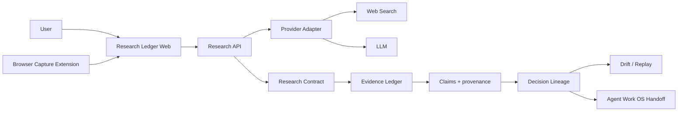

# REA Clean-Room Reverse Engineering Report — Research Ledger

## Target donor
Public target: SourceFrame (`sourceframe.app`) and its public Reddit launch post. This document uses only public product behavior, public marketing/docs, public Chrome Web Store metadata, and public policy pages. It does not inspect proprietary code, bypass access controls, or copy implementation details.

## Job to be done
Preserve research context so a user can reconstruct **why** a conclusion was reached: question → source set → evidence → claims → gaps → decision → later revision.

## Public capability extraction
Observed capabilities to independently implement:
1. Prompt-to-research and source discovery.
2. Explicit browser-tab capture.
3. Explicit AI-chat capture, labeled as AI context rather than verification.
4. Structured answer, summary, comparison, research, and recommendation artifacts.
5. Claim-to-source provenance.
6. Evidence gaps and caveats.
7. Follow-up questions grounded in the same source set.
8. Variants/version history.
9. Draft/export workflow.
10. Workspaces / reusable research state.

## Owned differentiation
Research Ledger is not a feature-for-feature clone. It adds:
- **Decision Lineage:** first-class graph of how prompts, assumptions, evidence, claims and decisions changed.
- **Evidence Drift:** scheduled or on-demand revalidation of source freshness and contradiction.
- **Research Contract:** machine-readable artifact for downstream agents.
- **Agent Work OS handoff:** accepted research becomes governed execution: plans, tasks, diagrams, code changes, tests, receipts.
- **Replay:** rerun a research state against newer sources and compare semantic changes.
- **Provider adapters:** web search/LLM is a swappable adapter instead of a hard-coded vendor dependency.

## Canonical REA / Agent Work OS flow
Source identity → public evidence capture → capability matrix → clean-room product contract → threat/permission model → independent implementation → tests → preview deploy → verification receipts → human gate → production.

## MVP architecture

## Security / privacy contract
- Capture is explicit; no passive browsing history ingestion.
- AI-chat content is context-only unless backed by independent sources.
- Minimal extension permissions.
- No credential scraping.
- No hidden background capture.
- Source URLs and excerpts stay user-visible and exportable.

## Current build status
- Web workspace: implemented.
- Evidence/claim/gap/lineage contract: implemented.
- Local persistence: implemented.
- JSON/Markdown export + Work OS handoff: implemented.
- Demo-safe fallback research engine: implemented.
- OpenAI Responses + web search adapter: implemented behind `OPENAI_API_KEY`.
- Chrome MV3 capture extension skeleton: implemented in the downloadable build.
- Drift UI/prototype: implemented; live source re-fetch service is next.
- Multi-user auth/database: next.
- Durable version/variant store: next.
- Scheduled evidence drift worker: next.
