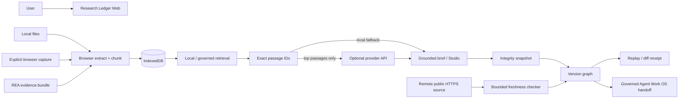

# REA Clean-Room Reverse Engineering Report — Research Ledger

## Target identity

**New donor:** ResearchBench (`VikingOwl91/research-bench`), surfaced from the Oct. 16, 2026 r/SideProject post “I spent 4 days on a take-home assignment. Things escalated.” The project describes itself as an open-source, browser-first NotebookLM-style research application using SvelteKit plus Rust/WebAssembly.

**Prior donor:** SourceFrame (`sourceframe.app`) and its public launch material. SourceFrame informed browser/AI-chat capture, structured research artifacts, provenance, evidence gaps and workspace ideas already present in Research Ledger.

REA treats both as evidence providers, not implementation authorities. Agent Work OS remains the authority for orchestration, provenance, clean-room boundaries, verification, replay and shipping gates.

## Public evidence captured from ResearchBench

Public README / launch evidence supports these capabilities:

1. Upload and organize PDF, Markdown and TXT source documents.
2. Local document processing, chunking, embeddings/indexing and semantic search.
3. Source-grounded Q&A with citations that open the cited passage.
4. Summary, FAQ and study-guide generation against the same source set.
5. Two-host AI-generated podcast output with cited transcript and audio playback/download.
6. Browser persistence for sources, indices, chat and generated material.
7. Bring-your-own/provider-based generation while local search works without a key.
8. Worker-based heavy processing and explicit cancellation/recovery paths.
9. Extensive automated unit, Rust, end-to-end and security testing.
10. Multilingual (English/German) experimentation.

## License / clean-room boundary

ResearchBench is **AGPL-3.0-or-later**. We do not transplant code, prompts, CSS, assets, tests or generated build output into Agent Work OS. This convergence is an independent implementation based on observable/public capabilities and our pre-existing Research Ledger contracts.

## Product consolidation decision

Do **not** create another standalone NotebookLM clone. ResearchBench becomes a donor for the existing **Research Ledger / Learn Anything** surface inside Agent Work OS.

Canonical ownership:

- **REA:** target identity, evidence capture, capability matrix, license/provenance record.
- **Research Ledger:** local source notebook, retrieval, citations, research artifacts, lineage, drift.
- **Learn Anything Studio:** learning-oriented presentation of summaries, FAQ and study guides when that UX is needed.
- **Agent Work OS:** downstream handoff, policy, replay, receipts, task/plan execution.
- **Creator / Presentation modules:** optional publication or presentation of accepted research outputs.

## Donor-to-owned capability matrix

| Public donor pattern | Research Ledger owned implementation | v0.3 status |
|---|---|---|
| Browser-first source library | IndexedDB source notebook | Implemented |
| PDF/TXT/MD ingestion | Browser extraction + PDF.js runtime adapter | Implemented |
| Chunk/index locally | Deterministic browser chunker | Implemented |
| Semantic retrieval | Governed lexical, vector and receipt-bound hybrid retrieval primitives | Implemented kernel; local browser embedding adapter still planned |
| Source-grounded Q&A | Top-passage retrieval + exact evidence IDs | Implemented |
| Click citation → passage | Passage dialog bound to local chunk ID | Implemented |
| Summary / FAQ / study guide | Studio output contract with local fallback + optional live generation | Implemented |
| Two-host podcast | Cited two-host transcript + local SpeechSynthesis playback | Implemented; audio download later |
| BYO/provider generation | Server-side provider adapter with local-only fallback | Implemented, different security model |
| Persistence | IndexedDB docs + durable browser snapshot history | Implemented |
| Version / replay | Integrity-bound snapshots, DAG lineage, deterministic diffs, replay receipts | Implemented in v0.3 |
| Remote freshness | Bounded HTTPS freshness checker with content hashes, redirect provenance and SSRF refusal | Kernel implemented; scheduler/UI wiring next |
| Agent handoff | Canonical `agent-work-os/research-handoff/v1` contract with execution approval gates | Implemented in v0.3 |
| Full local semantic embedding model | Web worker / local model | Planned |
| Downloadable rendered podcast audio | Local render/encoder pipeline | Planned |
| Large automated test matrix | Repository CI + integrity/adversarial tests; browser E2E/security matrix next | Partial |

## Owned differentiation

Research Ledger is intentionally more than a NotebookLM-style notebook:

- **Decision Lineage:** prompt → retrieved passages → claims → gaps → decision state.
- **Evidence Drift:** content-hashed local evidence plus bounded remote-source freshness receipts.
- **Research Contract:** machine-readable snapshot/version graph for downstream agents.
- **Agent Work OS handoff:** accepted research becomes governed plans, tasks, diagrams, code changes, tests and receipts without bypassing irreversible-action gates.
- **Replay:** older decisions can be compared against changed evidence and replay receipts bind the exact lineage.
- **REA bundle ingestion:** reverse-engineering evidence can enter the same provenance-aware notebook without being confused with independent verification.

## Canonical architecture

## Security / privacy contract

- Capture is explicit; no passive browsing history ingestion.
- Documents persist locally in browser IndexedDB.
- Local search does not require a provider key.
- Live generation receives bounded top passages, not the entire notebook by default.
- AI-chat content is context-only unless backed by independent source evidence.
- No credential scraping or hidden capture.
- Untrusted source text is rendered as text, not executable HTML.
- Input size and evidence-count limits are enforced at the server boundary.
- Remote freshness is HTTPS-only, refuses credential-bearing/non-default-port URLs, revalidates redirects, rejects localhost/private/reserved network targets, and records upstream failure as `unreachable` rather than “unchanged.”
- Research handoff may auto-advance reversible work but cannot authorize external writes, merge, production deployment, credential changes or billing changes.

## v0.3 verification gates

1. Repository-root `npm test` passes, including integrity/adversarial coverage for research snapshots, replay, handoff and source freshness.
2. Repository-root `npm run acceptance` passes.
3. Research Ledger local syntax/API smoke gate passes.
4. Browser history persists and can branch from an older snapshot without overwriting lineage.
5. Browser export uses the same canonical graph/handoff versions as the control-plane kernel.
6. Exact PR head SHA is green in CI.
7. Preview deployment must be built from that exact SHA and home + provider-status endpoint verified before a live deployment is claimed.
8. Production promotion remains a separate Shipping OS decision.

## Roadmap status after v0.3

1. **Local multilingual embedding model in a Web Worker, benchmarked against lexical retrieval** — kernel vector/hybrid contracts exist; production browser embedding adapter still open.
2. **Page-aware PDF citation geometry/highlighting** — open.
3. **Audio rendering/encoding worker for downloadable podcasts** — open.
4. **Durable notebook/version graph with explicit variants and replay diffs** — implemented in v0.3; browser E2E remains.
5. **Remote URL freshness fetcher and scheduled drift checks** — bounded freshness kernel implemented in v0.3; scheduler/control-plane job + browser status projection remain.
6. **Playwright E2E, accessibility, CSP/security and capacity benchmarks** — open and now the main shipping-quality lane.
7. **Native import/export contract shared with Learn Anything Studio and wider Agent Work OS capability registry** — governed Research Ledger → Agent Work OS handoff implemented; Learn Anything bidirectional import and capability-registry registration remain.
