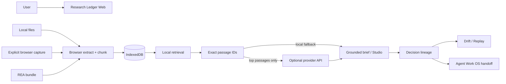

# REA Clean-Room Reverse Engineering Report — ResearchBench convergence

## Target identity

**Target:** ResearchBench (`VikingOwl91/research-bench`), surfaced from the Oct. 16, 2026 r/SideProject post “I spent 4 days on a take-home assignment. Things escalated.” The public launch describes an open-source, browser-first NotebookLM-style research application built with SvelteKit and Rust/WebAssembly.

REA classifies ResearchBench as a **donor/reference** for the existing Research Ledger capability inside Agent Work OS. It is not a new standalone owned product and does not get a new repository.

## Public capabilities extracted

1. Source-document upload and organization.
2. Browser/local document processing, chunking and search/RAG.
3. Source-grounded Q&A with citations that resolve to passages.
4. Summary, FAQ and study-guide generation against the same evidence set.
5. Two-host podcast-style output.
6. Browser persistence for source/project state.
7. Bring-your-own/provider generation while local research remains useful.
8. Worker/browser-first heavy processing patterns.
9. Automated verification and security attention.
10. Multilingual experimentation.

## License and clean-room boundary

The donor repository declares **AGPL-3.0-or-later**. Agent Work OS does not transplant donor code, prompts, CSS, assets, tests or generated build output. Public behavior and product capabilities are evidence only. The owned implementation uses pre-existing Research Ledger contracts and independently authored code.

## Canonical ownership

- **REA:** source identity, evidence capture, capability matrix, license/provenance record.
- **Research Ledger:** local source notebook, retrieval, exact citations, research artifacts, lineage and drift.
- **Learn Anything Studio:** optional learning-oriented presentation of summaries/FAQ/study guides.
- **Agent Work OS:** downstream orchestration, policy, replay, receipts, task/plan execution.
- **Creator / Presentation modules:** optional publication surfaces for accepted outputs.

## Donor-to-owned capability matrix

| Donor pattern | Owned implementation | v0.2 |
|---|---|---|
| Browser-first source library | IndexedDB source notebook | Implemented |
| PDF/TXT/MD ingestion | Browser extraction + PDF.js adapter | Implemented |
| Local chunk/index | Deterministic browser chunker | Implemented |
| Semantic retrieval | Lexical relevance retrieval now; embeddings later | Partial, honestly labeled |
| Grounded Q&A | Top-passage retrieval + exact passage IDs | Implemented |
| Citation → passage | Local passage inspector | Implemented |
| Summary / FAQ / study guide | Studio contract + local fallback + optional live synthesis | Implemented |
| Two-host podcast | Cited transcript + browser SpeechSynthesis | Implemented; audio file rendering later |
| Provider generation | Server adapter receives bounded retrieved passages only | Implemented, different privacy model |
| Persistence | IndexedDB documents + local snapshots | Implemented |
| Local embedding model | Worker/local model | Planned |
| Downloadable podcast audio | Local encoder/render pipeline | Planned |
| Broad E2E/security suite | API/syntax smoke gate now | Partial |

## Owned differentiation

- **Decision Lineage:** question → retrieved passages → claims → gaps → decision state.
- **Evidence Drift:** local evidence hashes now; remote freshness/contradiction checks next.
- **Research Contract:** machine-readable artifact for downstream agents.
- **Agent Work OS handoff:** accepted research becomes governed plans, tasks, diagrams, code changes, tests and receipts.
- **Replay:** future variants can compare old conclusions against changed evidence.
- **REA bundle ingestion:** reverse-engineering evidence can enter the notebook as provenance-bearing context without being mistaken for independent verification.

## Architecture

## Security / privacy contract

- Capture is explicit; no passive browsing-history ingestion.
- Documents persist browser-side.
- Local retrieval does not require a provider.
- Live generation receives bounded retrieved passages rather than the whole notebook by default.
- AI-chat imports are context unless backed by independent evidence.
- No credential scraping or hidden background capture.
- Untrusted source text is rendered as text, not executable HTML.
- Server evidence count and per-passage sizes are bounded.

## Release gates

1. Static JavaScript/API syntax passes.
2. API local-mode smoke tests pass.
3. Preview build reaches READY.
4. `GET /api/research` reports provider state without secrets.
5. Preview home page returns 200 and shows notebook controls.
6. Exact deployed Git SHA is recorded.
7. Production promotion remains a separate gate after preview verification.

## Next lanes

1. Local multilingual embedding model in a Web Worker, benchmarked against lexical retrieval.
2. Page-aware PDF citation geometry/highlighting.
3. Local podcast audio rendering/encoding.
4. Durable notebook/version graph with replay diffs.
5. Remote URL freshness fetcher and scheduled drift checks.
6. Playwright E2E, accessibility, CSP/security and capacity benchmarks.
7. Shared ResearchContract import/export with Learn Anything Studio and Agent Work OS capability registry.
