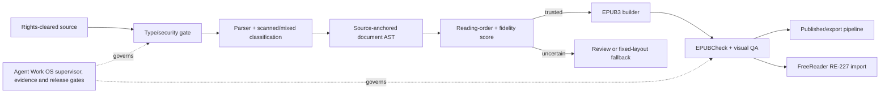

# Convert2EPUB → BookForge — REA F23/F24 intake
**Date:** 2026-10-23  
**Governance:** [Agent Work OS #375](https://github.com/rrahul0904/agent-work-os/issues/375)  
**Source:** https://www.reddit.com/r/ebooks/s/NcOTXKvrMo  
**Reference product:** https://convert2epub.com/

## Routing
- **EXTENSION / MODULE** to BookForge publisher/conversion capability, with dedicated product ownership to establish separately.
- **Do not** build a second reader: [RE-227 PDFreflow #326](https://github.com/rrahul0904/agent-work-os/issues/326) and [JustRead #282](https://github.com/rrahul0904/agent-work-os/issues/282) already cover reader-specific use cases.
- Agent Work OS is only the REA intake, evidence, agents, verification, gates and capabilities plane. This research artifact is not its production app.

## Evidence ledger (public claims are not runtime proof)
| ID | Evidence | Claim / constraint |
|---|---|---|
| C2E-001 | [Creator post](https://www.reddit.com/r/ebooks/comments/1xdbo4y/ive_been_building_a_tool_that_turns_any_pdf_or/) | EPUB conversion from PDF/DOCX/RTF/TXT/ODT/HTML/Markdown; chapter/TOC extraction, OCR, math/tables, translation, study tools, desktop/browser products (vendor claims) |
| C2E-002 | [Product/FAQ](https://convert2epub.com/) | Upload/config/credits; Pro described as page recognition via Mathpix; privacy/retention stated but not audited |
| C2E-003 | [Extension](https://convert2epub.com/extension/) | Article list to multi-chapter EPUB; local processing claimed, not security verified |
| C2E-004 | [Translation announcement](https://www.reddit.com/r/ebooks/comments/1x9duef/) | 15 target languages claimed; text in images not translated |
| C2E-005 | [W3C EPUBCheck](https://github.com/w3c/epubcheck) | Formal conformance gate available, not run on initial reference |
| C2E-006 | [Calibre](https://manual.calibre-ebook.com/generated/en/ebook-convert.html) | Independent downstream ebook format exporter |
| C2E-007 | [PyMuPDF4LLM](https://github.com/pymupdf/pymupdf4llm) | Layout-aware parser candidate, packaging/license review required |

## F24 bounded independent reference
A local Python reference (not vendor code) was authored and executed in the user artifact bundle:
- TXT/Markdown/HTML/DOCX/selectable-text PDF → deterministic EPUB3 with chapters and nav.
- HTML escaping, source/output SHA-256 and explicit quality warnings.
- 10/10 unit tests passed on synthetic tests; generated sample EPUB ZIP integrity and internal XML/TOC validator passed.
- Sample EPUB SHA-256: `4c43dbd53f1a89ca7356a4f86b4f22201031e1e139ccd5463150d93bf96fd60d`
- Python source SHA-256: `626ded847cfea751b39dd26b7906f91fbd0999a0566a179bb9c810e9c7de542c`
- The source/test/sample ZIP is attached directly in the originating ChatGPT conversation, **not committed to this research branch**. Do not claim GitHub CI tested it.

### Not implemented / not verified
OCR, mathematical fidelity, images, footnotes, table reconstruction, column ordering, translation, study tools, Kindle conversion, extension, UI, offline desktop/mobile, W3C EPUBCheck, real-device rendering, privacy audit, license clearance, integration and deployment.

## Proposed architecture

## Incremental gates
1. **F23** source, competitor, privacy and legal ledger — first pass complete; independent comparative fixtures outstanding.
2. **F24** local testable reference — bounded pass; GitHub source import and exact-SHA CI pending.
3. **F25** document AST/source anchors, multiple columns, figures, tables, math, OCR — not started.
4. **F26** EPUBCheck zero-error conformance, source-content coverage and Kindle/Kobo/Apple Books render — not started.
5. **F27** web, Mac/Windows/Linux, iOS/Android, browser extension — not started.
6. **F28** Book publishing and RE-227 integration, capability registry, replay receipts — not started.
7. **F29** independent security, license and release approvals — gated.

**Boundaries:** no copying closed-source implementation, DRM bypass, unauthorized copyrighted inputs, or automatic uploads. Explicit cloud-model consent, loss accounting and human review on uncertain technical content. No production merge/deploy without approval.
