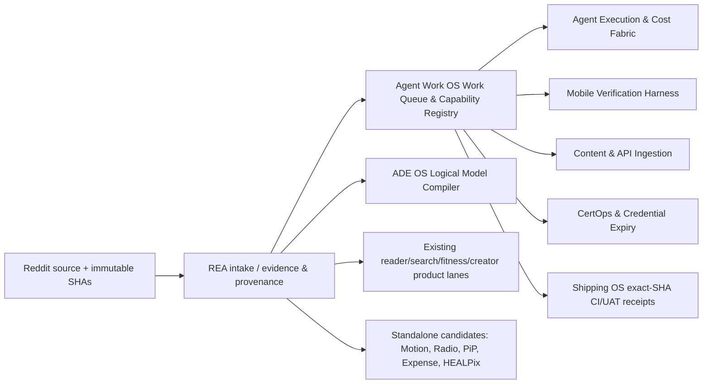

# REA casebook — SideProject GitHub showcase (2026-10-18)

> **Snapshot:** 2026-10-18, America/New_York. **Status:** SOURCES RESOLVED + FIRST-PASS SOURCE/README AUDIT + ROUTING COMPLETE; implementation, end-to-end runtime reconstruction and test/deployment receipts remain OPEN. This is not a statement of parity, production readiness or completed reverse engineering.

- Reddit source: https://www.reddit.com/r/SideProject/comments/1x925vo/lets_discover_each_others_github_projects/
- Original short URL: https://www.reddit.com/r/SideProject/s/d0AyFgyR5f
- Theme: u/Awacer, “Let's discover each other's GitHub projects!”; the main post is a request for developers to share open-source projects. Project evidence comes principally from distinct comments and linked repositories.
- Inventory reconciliation: **22 directly identifiable individual repository submissions** plus **one Api-Wrappers organization entry resolved into seven repositories** (six source/catalogue repos plus organization profile). **29 GitHub repositories/resources indexed**; count includes directory/profile/archived repos and must never be misreported as 29 independent products.
- This intake is an evidence snapshot, not a live monitor; new Reddit comments after snapshot require a new delta intake.
- All listed source commits were fetched from GitHub branch endpoints. Upstream heads can change; `sha` below pins the audited snapshot. README excerpts and project descriptions are upstream claims until independently tested.

## Repository policy and canonical ownership

- `DONOR` = extract capability/evidence in existing owned product; no clone/no independent repo.
- `MODULE` = add scoped feature branch in existing product owner after identifying canonical repo.
- `STANDALONE_CANDIDATE` = distinct product lifecycle/boundary; confirm dedupe, licensing and owned repo routing. The current connected GitHub interface cannot create repositories, so **none have been created**.
- REA governs source resolution, evidence, behavior captures, source hashes, licensing and replay. Agent Work OS governs work queue, capabilities/harness, approvals, execution, continuity and Shipping OS. ADE OS owns semantic-model compiler. Avoid new duplicate agent runtime, telemetry store, reader, search engine or fitness repo.

## 12-stage workflow and gate truth

| Stage | Expected evidence | This intake |
|---|---|---|
| 01 Resolve | Reddit permalink, author, every linked target, deduped aliases | DONE snapshot |
| 02 Source pin | exact upstream commit and repository URL, state, license signal | DONE first pass |
| 03 Product/workflow | target user, differentiator and primary user journeys | FIRST PASS from README |
| 04 Architecture/code | file-by-file modules, data stores, dependencies, APIs, trust boundary | OPEN beyond high-level source/docs |
| 05 Competitive benchmark | comparable open/closed products with reproducible criteria | INITIAL candidate list only |
| 06 Clean-room spec | BehaviorSpec, diagrams, PRD, feature parity vs deliberate divergence | OPEN |
| 07 REA capture | bounded sandbox observation; DOM/network/screens/videos where applicable | NOT EXECUTED |
| 08 Threat/license review | dependency-level SPDX/provenance, threat model and negative tests | INITIAL license flags only |
| 09 Owned implementation | correct canonical repo feature branch, adapters, tests | NOT EXECUTED |
| 10 Verify/replay | unit/integration/E2E, fixture hashes, human-readable logs | NOT EXECUTED |
| 11 Review/shipping | exact-head CI, independent review, diff and approval/rollback plan | NOT EXECUTED |
| 12 Release/UAT | real signed client/service deployed with observed runtime receipt | NOT EXECUTED |

## Triage index

| # | Target | Repository | Git SHA | License posture | Route | Priority |
|---:|---|---|---|---|---|---|
| 1 | TokenTimer Core | [tokentimerch/tokentimer-core](https://github.com/tokentimerch/tokentimer-core) | `3a5e276c6746` | AGPL-3.0 (plus separate commercial terms) | DONOR | P1 |
| 2 | TokenBill | [emrehangorgec/tokenbill](https://github.com/emrehangorgec/tokenbill) | `afe16a9b19f3` | MIT | DONOR | P0 |
| 3 | RunWield | [gandazgul/runwield](https://github.com/gandazgul/runwield) | `9154e7bbd7bf` | RunWield Free Use License — source-available; derivative redistribution restricted | DONOR | P0 |
| 4 | optimAIzr | [blendbunjaku/optimaizr](https://github.com/blendbunjaku/optimaizr) | `4bd6fbc58be6` | MIT | DONOR | P0 |
| 5 | Posecode | [posecode-dev/posecode](https://github.com/posecode-dev/posecode) | `953ab3ef79d2` | MIXED: Apache-2.0 spec/parser/LSP; AGPL-3.0 product/render/MCP; trademark separate | STANDALONE_CANDIDATE | P2 |
| 6 | Owlie | [mihaiiova/owlie](https://github.com/mihaiiova/owlie) | `1907ec41a163` | Apache-2.0 | DONOR | P0 |
| 7 | Lektra | [dheerajshenoy/lektra](https://github.com/dheerajshenoy/lektra) | `f292c61bfe07` | AGPL-3.0 | MODULE | P2 |
| 8 | hpvis | [dheerajshenoy/hpvis](https://github.com/dheerajshenoy/hpvis) | `c57799f9e8d1` | AGPL-3.0 | STANDALONE_CANDIDATE | P3 |
| 9 | DrexiusTerminal | [DreyDreamer17/drexius-terminal](https://github.com/DreyDreamer17/drexius-terminal) | `bc6a226a2394` | GPL-3.0 | DONOR | P1 |
| 10 | Brambit | [morethanrealio/brambit](https://github.com/morethanrealio/brambit) | `1b53646e4d3a` | AGPL-3.0 | DONOR | P0 |
| 11 | SUB/WAVE | [perminder-klair/subwave](https://github.com/perminder-klair/subwave) | `7cb507f517d7` | MIT | STANDALONE_CANDIDATE | P2 |
| 12 | LocalSend32 | [fraaaaa4/LocalSend32](https://github.com/fraaaaa4/LocalSend32) | `dfcf3bdd419c` | NO LICENSE FILE FOUND — permission not established | DONOR | P3 |
| 13 | Ecureuil | [fraaaaa4/ecureuil](https://github.com/fraaaaa4/ecureuil) | `db499632a6a6` | NO LICENSE FILE FOUND — permission not established | DONOR | P3 |
| 14 | OpenCode Dollar Code Edition | [emperorofrome13/opencode-dollar-code-edition](https://github.com/emperorofrome13/opencode-dollar-code-edition) | `65625d35431b` | MIT indicated by repository; upstream fork dependencies must be audited | DONOR | P1 |
| 15 | WildCat Export Edition | [emperorofrome13/WildCat-Export-Edition](https://github.com/emperorofrome13/WildCat-Export-Edition) | `3104d1fe69a0` | NO LICENSE FILE FOUND — README explicitly requests choosing license | MODULE | P2 |
| 16 | Scry | [R-Hatim/scry](https://github.com/R-Hatim/scry) | `628f1196496b` | MIT | DONOR | P1 |
| 17 | Drizzle Cube | [cliftonc/drizzle-cube](https://github.com/cliftonc/drizzle-cube) | `0824c7471212` | MIT | DONOR | P0 |
| 18 | PiP Companion | [kir4che/pip-companion](https://github.com/kir4che/pip-companion) | `e50c9d6a9644` | MIT | STANDALONE_CANDIDATE | P2 |
| 19 | WattLoom Cycling | [Ashikaga1974/WattLoom](https://github.com/Ashikaga1974/WattLoom) | `5454c0d3a532` | AGPL-3.0 | MODULE | P2 |
| 20 | Quern | [quern-dev/quern](https://github.com/quern-dev/quern) | `b8514cd1774c` | Apache-2.0 | DONOR | P0 |
| 21 | bida | [theoldg/bida](https://github.com/theoldg/bida) | `db708f07dfb1` | MIT | STANDALONE_CANDIDATE | P2 |
| 22 | Cozy Watch | [Cozy-Watch/CozyWatch](https://github.com/Cozy-Watch/CozyWatch) | `15962b29d2c8` | MIT (branding/assets excluded) | DONOR | P1 |

## Individual project dossiers

### REA-SG-01 · TokenTimer Core

- **Upstream:** [tokentimerch/tokentimer-core](https://github.com/tokentimerch/tokentimer-core/tree/3a5e276c67467008f9c0bef50d1665bfa1bae794) · default-branch observed commit `3a5e276c67467008f9c0bef50d1665bfa1bae794`.
- **License/provenance:** AGPL-3.0 (plus separate commercial terms). Inspect root and nested licenses before importing code; branding/third-party components are separately controlled.
- **Routing:** **DONOR** → Agent Work OS / governed Credential Expiry & CertOps provider. **Priority:** P1.
- **Problem/capabilities:** Self-hosted inventory of expiring certs, credentials, tokens and licenses; approvals, alert escalation, supported outbound-only certificate executors, renewal/rollback/verification; control plane does not possess customer certificate private keys.
- **Architecture reconstruction (documentary, not runtime-verified):** Monorepo with apps, packages, worker queue, deployment Helm, docs, tests; certificate agents plus controller and provider integrations; inspect `apps/worker/queue-architecture.md` and `docs/certops/agent.md` for exact contracts.
- **BehaviorSpec candidate:** Provider/source discovery → asset inventory + owner → expiry policy → alert/approval → renewal agent → deploy + verify → immutable audit receipt.
- **Competitor/benchmark set:** cert-manager, Vault and native cloud certificate managers; separate inventory and cert-automation from provider-owned secret storage.
- **Threats and licensing boundaries:** Private-key exfiltration, privileged certificate deployment, DNS authorization and cert renewal failures; AGPL means clean-room or legally reviewed isolation.
- **Acceptance/negative tests to implement:** Air-gapped simulated expiry, approval-required renewal, bad DNS validation, changed host key, failed deploy with rollback, idempotent retry and audit evidence.
- **Open deliverables:** source dependency diagram; data model/API map; user-flow screenshots or CLI recordings; contributor/legal provenance matrix; fixture pack + deterministic evaluator; owned component/contract; PRD, tickets and signed execution/replay/CI receipts.
- **Current gate:** README/repo metadata/source SHA examined; code-level source audit, execution, comparator measurements, implementation, and deployment unverified.

### REA-SG-02 · TokenBill

- **Upstream:** [emrehangorgec/tokenbill](https://github.com/emrehangorgec/tokenbill/tree/afe16a9b19f34e3c0ac3b8d6834d36f90e4acf37) · default-branch observed commit `afe16a9b19f34e3c0ac3b8d6834d36f90e4acf37`.
- **License/provenance:** MIT. Inspect root and nested licenses before importing code; branding/third-party components are separately controlled.
- **Routing:** **DONOR** → Agent Work OS / AgentSessionTelemetry and Cost Intelligence (#66). **Priority:** P0.
- **Problem/capabilities:** Local Claude Code session transcript cost itemization, overhead/compaction/cache attribution, recommendations and status-line or CI-budget projection; without sending logs to a service.
- **Architecture reconstruction (documentary, not runtime-verified):** Node/npm local CLI reading session logs; inspect price-version semantics and status-line interface before adoption.
- **BehaviorSpec candidate:** Read session log → normalize tokens and pricing provenance → compute cache/overhead → cost report → configurable budget alert.
- **Competitor/benchmark set:** optimAIzr and ccusage; preserve estimated versus billed cost and pricing-source date.
- **Threats and licensing boundaries:** Session secrets, nonportable Claude log schema, false precision on estimated pricing and prompt data leakage.
- **Acceptance/negative tests to implement:** Golden partial/full logs, cache-prefix change, missing price table, mixed agents, stale sessions, no-network guarantee and budget threshold.
- **Open deliverables:** source dependency diagram; data model/API map; user-flow screenshots or CLI recordings; contributor/legal provenance matrix; fixture pack + deterministic evaluator; owned component/contract; PRD, tickets and signed execution/replay/CI receipts.
- **Current gate:** README/repo metadata/source SHA examined; code-level source audit, execution, comparator measurements, implementation, and deployment unverified.

### REA-SG-03 · RunWield

- **Upstream:** [gandazgul/runwield](https://github.com/gandazgul/runwield/tree/9154e7bbd7bfa2f832feff2e233a621684faf707) · default-branch observed commit `9154e7bbd7bfa2f832feff2e233a621684faf707`.
- **License/provenance:** RunWield Free Use License — source-available; derivative redistribution restricted. Inspect root and nested licenses before importing code; branding/third-party components are separately controlled.
- **Routing:** **DONOR** → Agent Work OS / Agent Execution Fabric and Workbench (#267). **Priority:** P0.
- **Problem/capabilities:** Risk-adjusted plan→human approval→specialized agent execution→CI and independent code review→decision memory. Exposes a staged planned change rather than unreviewed autonomous edits.
- **Architecture reconstruction (documentary, not runtime-verified):** Bun/TypeScript workspace with execution orchestration, skills, docs, container config and local UI; exact internal state machine awaits file-level review.
- **BehaviorSpec candidate:** Idea/issue → risk classification → explicit PlanSpec → approval → worktree execution → CI → independent reviewer → recorded decision.
- **Competitor/benchmark set:** Aider, OpenHands, Superset and existing Agent Work OS governance; do not duplicate session store.
- **Threats and licensing boundaries:** Custom restrictive license, unapproved writes, prompt injection in repo, reviewer self-approval, forged CI success.
- **Acceptance/negative tests to implement:** No-write before approval, gated escalation, sabotage fixture, independent review identity, signed exact-SHA CI and replay consistency.
- **Open deliverables:** source dependency diagram; data model/API map; user-flow screenshots or CLI recordings; contributor/legal provenance matrix; fixture pack + deterministic evaluator; owned component/contract; PRD, tickets and signed execution/replay/CI receipts.
- **Current gate:** README/repo metadata/source SHA examined; code-level source audit, execution, comparator measurements, implementation, and deployment unverified.

### REA-SG-04 · optimAIzr

- **Upstream:** [blendbunjaku/optimaizr](https://github.com/blendbunjaku/optimaizr/tree/4bd6fbc58be6d446fc408ab8ac9aaa652c6713d2) · default-branch observed commit `4bd6fbc58be6d446fc408ab8ac9aaa652c6713d2`.
- **License/provenance:** MIT. Inspect root and nested licenses before importing code; branding/third-party components are separately controlled.
- **Routing:** **DONOR** → Agent Work OS / Agent Cost & Context Intelligence (#66). **Priority:** P0.
- **Problem/capabilities:** Local analyzer of Claude Code, Codex and OpenCode token usage, cache expiration, repeated context and command-driven optimization; claims no account, upload or telemetry.
- **Architecture reconstruction (documentary, not runtime-verified):** Node CLI with log adapters and tool-call metadata analysis; examine provider adapters, privacy guarantees and CI fixtures.
- **BehaviorSpec candidate:** Discover local session → normalize context/cache counters → detect waste → show ranked opportunities → user-approved optimization.
- **Competitor/benchmark set:** TokenBill and other cost monitors; focus on provider-neutral economics and observable evidence, not imagined savings.
- **Threats and licensing boundaries:** Sensitive tool arguments in reports, provider cache semantics mismatches, misleading monetary savings and destructive automated config edits.
- **Acceptance/negative tests to implement:** Three-provider fixtures, prefix-change versus cache-timeout, token accounting reconciliation, prompt redaction, zero outbound telemetry.
- **Open deliverables:** source dependency diagram; data model/API map; user-flow screenshots or CLI recordings; contributor/legal provenance matrix; fixture pack + deterministic evaluator; owned component/contract; PRD, tickets and signed execution/replay/CI receipts.
- **Current gate:** README/repo metadata/source SHA examined; code-level source audit, execution, comparator measurements, implementation, and deployment unverified.

### REA-SG-05 · Posecode

- **Upstream:** [posecode-dev/posecode](https://github.com/posecode-dev/posecode/tree/953ab3ef79d23d00310c3bb227f6aebd48fe82fe) · default-branch observed commit `953ab3ef79d23d00310c3bb227f6aebd48fe82fe`.
- **License/provenance:** MIXED: Apache-2.0 spec/parser/LSP; AGPL-3.0 product/render/MCP; trademark separate. Inspect root and nested licenses before importing code; branding/third-party components are separately controlled.
- **Routing:** **STANDALONE_CANDIDATE** → MotionSpec Studio (new distinct motion-DSL product lane) with shared Technical Visual Studio adapters. **Priority:** P2.
- **Problem/capabilities:** Deterministic inspectable text DSL for human kinematic motion with parser, validation, 3D rendering, share transport, LSP, editor plugins, MCP and evaluation.
- **Architecture reconstruction (documentary, not runtime-verified):** Package monorepo split into spec, parser, language/LSP, editors, renderer/embed/MCP/playground and tests; licensing must be enforced at package boundaries.
- **BehaviorSpec candidate:** Prompt/manual text → grammar + validation → motion IR → deterministic preview → edit/diff → export/embed/evaluate.
- **Competitor/benchmark set:** BVH, FBX, Three.js motion tooling and black-box text-to-motion systems.
- **Threats and licensing boundaries:** Unsafe motion outputs, physical realism claims, AGPL component import into closed-source, third-party assets/trademarks.
- **Acceptance/negative tests to implement:** Grammar round-trip, determinism, invalid joint constraints, motion replay, malformed file fuzz and license-boundary checks.
- **Open deliverables:** source dependency diagram; data model/API map; user-flow screenshots or CLI recordings; contributor/legal provenance matrix; fixture pack + deterministic evaluator; owned component/contract; PRD, tickets and signed execution/replay/CI receipts.
- **Current gate:** README/repo metadata/source SHA examined; code-level source audit, execution, comparator measurements, implementation, and deployment unverified.

### REA-SG-06 · Owlie

- **Upstream:** [mihaiiova/owlie](https://github.com/mihaiiova/owlie/tree/1907ec41a1632982aaa305f7ffd0a12b499aca22) · default-branch observed commit `1907ec41a1632982aaa305f7ffd0a12b499aca22`.
- **License/provenance:** Apache-2.0. Inspect root and nested licenses before importing code; branding/third-party components are separately controlled.
- **Routing:** **DONOR** → REA / governed multimodal evidence extraction and source adapters (#88). **Priority:** P0.
- **Problem/capabilities:** Local-friendly Node CLI extracting text and metadata from articles, YouTube videos, podcast media, RSS/Atom and Hacker News; optional LLM processing; versioned JSON envelopes and pipeable output.
- **Architecture reconstruction (documentary, not runtime-verified):** Node 22+ CLI with source-specific resolvers, YouTube transcripts and optional local ffmpeg/Whisper audio path; extraction and LLM processing remain separate.
- **BehaviorSpec candidate:** URL + source policy → source type resolver → bounded fetch/extract → normalized source envelope → optional model transform → provenance receipt.
- **Competitor/benchmark set:** yt-dlp, Readability, trafilatura, feedparser; ensure quotes and source attribution.
- **Threats and licensing boundaries:** SSRF, untrusted HTML, prompt injection, media copyright, redirects, resource-limit bypass and source drift.
- **Acceptance/negative tests to implement:** Local fixture corpus of 5 source types, no external redirect, bounded downloads, deterministic normalized schema, malicious HTML and no forced LLM inference.
- **Open deliverables:** source dependency diagram; data model/API map; user-flow screenshots or CLI recordings; contributor/legal provenance matrix; fixture pack + deterministic evaluator; owned component/contract; PRD, tickets and signed execution/replay/CI receipts.
- **Current gate:** README/repo metadata/source SHA examined; code-level source audit, execution, comparator measurements, implementation, and deployment unverified.

### REA-SG-07 · Lektra

- **Upstream:** [dheerajshenoy/lektra](https://github.com/dheerajshenoy/lektra/tree/f292c61bfe07d93b52496fdb78f67a451e6c7dfa) · default-branch observed commit `f292c61bfe07d93b52496fdb78f67a451e6c7dfa`.
- **License/provenance:** AGPL-3.0. Inspect root and nested licenses before importing code; branding/third-party components are separately controlled.
- **Routing:** **MODULE** → Existing Reader/JustRead product lane — verify canonical owned repository before feature branch. **Priority:** P2.
- **Problem/capabilities:** Early-stage high-performance C++ viewer for PDFs, XPS/OXPS, CBZ, FB2, EPUB/Mobi, DjVu and many image types with space-efficient controls.
- **Architecture reconstruction (documentary, not runtime-verified):** Native C++ document/image decoding with file-format integrations; README explicitly says early and not production-ready.
- **BehaviorSpec candidate:** Open file → identify format → safe decode → page/image viewport → navigation/annotations → persistent reading state.
- **Competitor/benchmark set:** Zathura, SumatraPDF, Okular and JustRead reader vision.
- **Threats and licensing boundaries:** Malformed document parser RCE, archive bombs, large memory spikes and AGPL embedding limits.
- **Acceptance/negative tests to implement:** Untrusted sample corpus, encrypted PDFs, giant images, fuzz decoders, keyboard/accessibility and memory baseline.
- **Open deliverables:** source dependency diagram; data model/API map; user-flow screenshots or CLI recordings; contributor/legal provenance matrix; fixture pack + deterministic evaluator; owned component/contract; PRD, tickets and signed execution/replay/CI receipts.
- **Current gate:** README/repo metadata/source SHA examined; code-level source audit, execution, comparator measurements, implementation, and deployment unverified.

### REA-SG-08 · hpvis

- **Upstream:** [dheerajshenoy/hpvis](https://github.com/dheerajshenoy/hpvis/tree/c57799f9e8d128e8415072b9fdfdd73f6d465fa4) · default-branch observed commit `c57799f9e8d128e8415072b9fdfdd73f6d465fa4`.
- **License/provenance:** AGPL-3.0. Inspect root and nested licenses before importing code; branding/third-party components are separately controlled.
- **Routing:** **STANDALONE_CANDIDATE** → Scientific Visualization / HEALPix Viewer lane, not Agent Work OS execution core. **Priority:** P3.
- **Problem/capabilities:** GPU-accelerated HEALPix sky-map viewer with GLSL-style per-pixel lookup, 14 projections, coordinate frames, masks, color maps, FITS/NumPy input and multi-tab exploration.
- **Architecture reconstruction (documentary, not runtime-verified):** GPU projection/pixel lookup in fragment shaders; scientific file loaders, coordinate transforms and map-expression engine; source modules to be audited.
- **BehaviorSpec candidate:** Import FITS/NumPy → choose HDU and ordering → map/project in GPU → interactive sky pan/zoom → masks/expressions → export.
- **Competitor/benchmark set:** healpy plotting, Aladin and astronomical FITS viewers.
- **Threats and licensing boundaries:** Projection numeric correctness, massive arrays/VRAM, malformed FITS and restrictive AGPL.
- **Acceptance/negative tests to implement:** Nside 2048 stress, RING/NESTED equivalence, known coordinate transformation fixtures, 14 projection golden images.
- **Open deliverables:** source dependency diagram; data model/API map; user-flow screenshots or CLI recordings; contributor/legal provenance matrix; fixture pack + deterministic evaluator; owned component/contract; PRD, tickets and signed execution/replay/CI receipts.
- **Current gate:** README/repo metadata/source SHA examined; code-level source audit, execution, comparator measurements, implementation, and deployment unverified.

### REA-SG-09 · DrexiusTerminal

- **Upstream:** [DreyDreamer17/drexius-terminal](https://github.com/DreyDreamer17/drexius-terminal/tree/bc6a226a23942f0c5bc1fd4a7bacb282a8b7f88d) · default-branch observed commit `bc6a226a23942f0c5bc1fd4a7bacb282a8b7f88d`.
- **License/provenance:** GPL-3.0. Inspect root and nested licenses before importing code; branding/third-party components are separately controlled.
- **Routing:** **DONOR** → AgentDock / Agent Work OS secure local/remote terminal workspace. **Priority:** P1.
- **Problem/capabilities:** Tauri 2/Rust, React local-first terminal: SSH/SFTP, tunnels, serial, SQLCipher vault, relay sync, local/remote agents and Android/desktop releases.
- **Architecture reconstruction (documentary, not runtime-verified):** `src-tauri` Rust backend, React `src`, relay, docs and security tests; browser demo uses simulated shell and is NOT an SSH/security proof.
- **BehaviorSpec candidate:** Unlock encrypted vault → select host/local shell → verify host key → create terminal/SFTP/tunnel → gated AI assistance → optional encrypted relay sync.
- **Competitor/benchmark set:** Termius, Tabby, OpenSSH, WinSCP.
- **Threats and licensing boundaries:** Host-key trust, SQLCipher key handling, compromised relay, unsafe terminal automation, agent credential exposure and GPL obligations.
- **Acceptance/negative tests to implement:** Changed key fail-closed, vault recovery/lockout, tunnel SSRF, agent deny policy, Windows/macOS/Android packaging and real SSH receipt.
- **Open deliverables:** source dependency diagram; data model/API map; user-flow screenshots or CLI recordings; contributor/legal provenance matrix; fixture pack + deterministic evaluator; owned component/contract; PRD, tickets and signed execution/replay/CI receipts.
- **Current gate:** README/repo metadata/source SHA examined; code-level source audit, execution, comparator measurements, implementation, and deployment unverified.

### REA-SG-10 · Brambit

- **Upstream:** [morethanrealio/brambit](https://github.com/morethanrealio/brambit/tree/1b53646e4d3a239891542205e7069a501c35bb40) · default-branch observed commit `1b53646e4d3a239891542205e7069a501c35bb40`.
- **License/provenance:** AGPL-3.0. Inspect root and nested licenses before importing code; branding/third-party components are separately controlled.
- **Routing:** **DONOR** → Agent Work OS / multi-tenant personal assistant + memory/connector/runtime. **Priority:** P0.
- **Problem/capabilities:** Self-hosted multi-user AI assistants with isolated accounts, memory, browser/WhatsApp/Telegram/email/Slack, Google/Microsoft/GitHub/MCP, sandboxed code and schedules.
- **Architecture reconstruction (documentary, not runtime-verified):** Node 24 app with Postgres-based backing and channel/connectors, app-hosting, sandbox and scheduled routines; validate tenant trust boundaries in source.
- **BehaviorSpec candidate:** Admin install → member invite → individual assistant + model key → messaging/channel connection → memory/tool sandbox → approved scheduled action.
- **Competitor/benchmark set:** OpenClaw, LibreChat and existing Agent Work OS persistent coworkers.
- **Threats and licensing boundaries:** Cross-tenant memory leakage, connector permission escalation, sandbox breakout, unapproved outbound messages, cost abuse and AGPL.
- **Acceptance/negative tests to implement:** Two-tenant leak attempt, malicious connectors, approval gate, model key isolation, revoke user/tool, replay with no external send.
- **Open deliverables:** source dependency diagram; data model/API map; user-flow screenshots or CLI recordings; contributor/legal provenance matrix; fixture pack + deterministic evaluator; owned component/contract; PRD, tickets and signed execution/replay/CI receipts.
- **Current gate:** README/repo metadata/source SHA examined; code-level source audit, execution, comparator measurements, implementation, and deployment unverified.

### REA-SG-11 · SUB/WAVE

- **Upstream:** [perminder-klair/subwave](https://github.com/perminder-klair/subwave/tree/7cb507f517d7483c25c75918d1659804daddc357) · default-branch observed commit `7cb507f517d7483c25c75918d1659804daddc357`.
- **License/provenance:** MIT. Inspect root and nested licenses before importing code; branding/third-party components are separately controlled.
- **Routing:** **STANDALONE_CANDIDATE** → Owned AI Radio / Media Station product, with Creator Console content adapter. **Priority:** P2.
- **Problem/capabilities:** Internet radio with synchronized Icecast stream; AI DJ chooses music and narrates, voice personas, scheduled programs, optional hosted service and mobile/desktop players.
- **Architecture reconstruction (documentary, not runtime-verified):** Docker compose with Icecast/Liquidsoap, scheduling/controller, admin web/CLI, pluggable TTS/LLM and hosted service boundary.
- **BehaviorSpec candidate:** Import licensed music → configure station/DJ voice → create 24x7 schedule → generate transitions → broadcast → live player/diagnostics.
- **Competitor/benchmark set:** AzuraCast, LibreTime and Navidrome; music-streaming rights differ by region/use.
- **Threats and licensing boundaries:** Music performance/streaming rights, TTS consent, unsafe live speech, runaway compute and station availability.
- **Acceptance/negative tests to implement:** Deterministic fake music catalog, timed transitions, permissioned audio sources, reconnect/restart, empty library and copyright-policy checks.
- **Open deliverables:** source dependency diagram; data model/API map; user-flow screenshots or CLI recordings; contributor/legal provenance matrix; fixture pack + deterministic evaluator; owned component/contract; PRD, tickets and signed execution/replay/CI receipts.
- **Current gate:** README/repo metadata/source SHA examined; code-level source audit, execution, comparator measurements, implementation, and deployment unverified.

### REA-SG-12 · LocalSend32

- **Upstream:** [fraaaaa4/LocalSend32](https://github.com/fraaaaa4/LocalSend32/tree/dfcf3bdd419c694ff70591b0e85067d71cd02595) · default-branch observed commit `dfcf3bdd419c694ff70591b0e85067d71cd02595`.
- **License/provenance:** NO LICENSE FILE FOUND — permission not established. Inspect root and nested licenses before importing code; branding/third-party components are separately controlled.
- **Routing:** **DONOR** → AgentDock / Local Device File Exchange + legacy compatibility. **Priority:** P3.
- **Problem/capabilities:** Lean native C/Win32 LocalSend v2 file transfer across Windows NT/2000/RT ARM32/ARM64-era targets with UDP discovery and TLS transfer.
- **Architecture reconstruction (documentary, not runtime-verified):** C11 Win32 UI, OpenSSL TLS, UDP discovery, sender/receiver handshake and INI settings; compatibility matrix defined in README.
- **BehaviorSpec candidate:** Detect peer → trust device → negotiate transfer → accept or reject → encrypted upload/download → verify digest.
- **Competitor/benchmark set:** Official LocalSend, KDE Connect; prioritize protocol interoperability over platform legacy clones.
- **Threats and licensing boundaries:** Unknown redistribution rights, legacy TLS support, spoofed peer, path traversal, file overwrite and Windows support claims.
- **Acceptance/negative tests to implement:** Old-Windows compile matrix, discovery spoof, TLS failure, binary integrity, transfer cancellation and path traversal.
- **Open deliverables:** source dependency diagram; data model/API map; user-flow screenshots or CLI recordings; contributor/legal provenance matrix; fixture pack + deterministic evaluator; owned component/contract; PRD, tickets and signed execution/replay/CI receipts.
- **Current gate:** README/repo metadata/source SHA examined; code-level source audit, execution, comparator measurements, implementation, and deployment unverified.

### REA-SG-13 · Ecureuil

- **Upstream:** [fraaaaa4/ecureuil](https://github.com/fraaaaa4/ecureuil/tree/db499632a6a6e9c3e36dbb15325c96d5ed3f51d2) · default-branch observed commit `db499632a6a6e9c3e36dbb15325c96d5ed3f51d2`.
- **License/provenance:** NO LICENSE FILE FOUND — permission not established. Inspect root and nested licenses before importing code; branding/third-party components are separately controlled.
- **Routing:** **DONOR** → AgentDock / governed app-catalog distribution adapter and release provenance. **Priority:** P3.
- **Problem/capabilities:** C#/WinForms .NET legacy app repository manager: JSON source/index fetch, cache, architecture/OS matching, download/install/uninstall records and shortcuts.
- **Architecture reconstruction (documentary, not runtime-verified):** `Models`, `Services`, `Helpers`, source JSON; repository contains a `.pfx` signing-looking file — handle as potentially sensitive, never copy into our tree.
- **BehaviorSpec candidate:** Add source → fetch+cache signed manifest → compatibility filter → download → verify hash/signature → explicit install → inventory.
- **Competitor/benchmark set:** Scoop, Chocolatey and WinGet, adapted for low-resource/old Windows.
- **Threats and licensing boundaries:** Untrusted package manifests, remote installer execution, archive traversal, supply-chain trust, signing material exposure and absent license.
- **Acceptance/negative tests to implement:** Manifest signature failure, malicious installer rejection, rollback/uninstall, offline cache and unsupported-architecture denial.
- **Open deliverables:** source dependency diagram; data model/API map; user-flow screenshots or CLI recordings; contributor/legal provenance matrix; fixture pack + deterministic evaluator; owned component/contract; PRD, tickets and signed execution/replay/CI receipts.
- **Current gate:** README/repo metadata/source SHA examined; code-level source audit, execution, comparator measurements, implementation, and deployment unverified.

### REA-SG-14 · OpenCode Dollar Code Edition

- **Upstream:** [emperorofrome13/opencode-dollar-code-edition](https://github.com/emperorofrome13/opencode-dollar-code-edition/tree/65625d35431b318b8046890d120e6897ea003f55) · default-branch observed commit `65625d35431b318b8046890d120e6897ea003f55`.
- **License/provenance:** MIT indicated by repository; upstream fork dependencies must be audited. Inspect root and nested licenses before importing code; branding/third-party components are separately controlled.
- **Routing:** **DONOR** → AgentDock / Agent Harness Compiler & Cost-Aware Context Policies. **Priority:** P1.
- **Problem/capabilities:** Independent OpenCode fork claiming fewer first-turn tokens through leaner prompts/tool definitions and optional RTK/DCP compression; includes a reproducible A/B token harness.
- **Architecture reconstruction (documentary, not runtime-verified):** Bun/TypeScript OpenCode fork with `script/token-ab/` benchmark harness; inspect upstream attribution and commit ancestry.
- **BehaviorSpec candidate:** Same task fixtures → upstream/fork prompt capture → tokenizer-normalized delta → correctness review → guarded context policy.
- **Competitor/benchmark set:** Official OpenCode, optimAIzr, tokenbill; fewer input tokens alone do not imply lower billed cost or parity.
- **Threats and licensing boundaries:** Benchmark cherry-picking, model/tool loss, stale upstream security patches and fork-specific license obligations.
- **Acceptance/negative tests to implement:** Matched task/tokenizer/model baselines, blind reviewer success criteria, all tool schemas, cache pricing and nightly upstream drift.
- **Open deliverables:** source dependency diagram; data model/API map; user-flow screenshots or CLI recordings; contributor/legal provenance matrix; fixture pack + deterministic evaluator; owned component/contract; PRD, tickets and signed execution/replay/CI receipts.
- **Current gate:** README/repo metadata/source SHA examined; code-level source audit, execution, comparator measurements, implementation, and deployment unverified.

### REA-SG-15 · WildCat Export Edition

- **Upstream:** [emperorofrome13/WildCat-Export-Edition](https://github.com/emperorofrome13/WildCat-Export-Edition/tree/3104d1fe69a0e03d6ce4fc36640b21717acecff5) · default-branch observed commit `3104d1fe69a0e03d6ce4fc36640b21717acecff5`.
- **License/provenance:** NO LICENSE FILE FOUND — README explicitly requests choosing license. Inspect root and nested licenses before importing code; branding/third-party components are separately controlled.
- **Routing:** **MODULE** → Creator Console / local ComfyUI image batch and prompt workflow. **Priority:** P2.
- **Problem/capabilities:** Windows local batch ComfyUI image workspace; optional Ollama/LM Studio/Codex/Claude prompt backends, workflow JSON import, queues, review/rating and local output.
- **Architecture reconstruction (documentary, not runtime-verified):** Python local control panel and ComfyUI REST/websocket integration with prompt backends and separated queues; models are not bundled.
- **BehaviorSpec candidate:** Import workflow → validate allowed nodes → choose local/model prompt backend → queue batch → render → inspect/rate/export with provenance.
- **Competitor/benchmark set:** ComfyUI native workflow and local image batch tools.
- **Threats and licensing boundaries:** No upstream redistribution grant, ComfyUI custom-node unsafe execution, prompt data egress, GPU OOM and untrusted workflow imports.
- **Acceptance/negative tests to implement:** Mock local ComfyUI, resource budget, malformed workflow, absent model, explicit cloud consent and per-render seed/provenance.
- **Open deliverables:** source dependency diagram; data model/API map; user-flow screenshots or CLI recordings; contributor/legal provenance matrix; fixture pack + deterministic evaluator; owned component/contract; PRD, tickets and signed execution/replay/CI receipts.
- **Current gate:** README/repo metadata/source SHA examined; code-level source audit, execution, comparator measurements, implementation, and deployment unverified.

### REA-SG-16 · Scry

- **Upstream:** [R-Hatim/scry](https://github.com/R-Hatim/scry/tree/628f1196496b343254678505f6683efcf6b17f42) · default-branch observed commit `628f1196496b343254678505f6683efcf6b17f42`.
- **License/provenance:** MIT. Inspect root and nested licenses before importing code; branding/third-party components are separately controlled.
- **Routing:** **DONOR** → Existing BeaconFind / Local Knowledge Search Engine (#174). **Priority:** P1.
- **Problem/capabilities:** Windows Rust whole-disk filename/full-content indexed search, typo tolerance, small daemon + CLI + hotkey bar, fast incremental maintenance.
- **Architecture reconstruction (documentary, not runtime-verified):** Rust daemon/incremental index, document extractors and UI/tray overlay; claims millisecond lookup (needs independent benchmarks).
- **BehaviorSpec candidate:** Grant folders → initial index → filesystem change journal → query hotkey/CLI → fuzzy/fulltext results → preview/open.
- **Competitor/benchmark set:** Everything, fsearch and BeaconFind semantic search; avoid duplicate index services.
- **Threats and licensing boundaries:** Unauthorized file indexing, stale/deleted search hits, symlink traversal, sensitive content and startup permissions.
- **Acceptance/negative tests to implement:** NTFS rename/delete, huge corpus benchmark, Unicode and typo tests, ACL denial, symlink loops and cold/warm index receipts.
- **Open deliverables:** source dependency diagram; data model/API map; user-flow screenshots or CLI recordings; contributor/legal provenance matrix; fixture pack + deterministic evaluator; owned component/contract; PRD, tickets and signed execution/replay/CI receipts.
- **Current gate:** README/repo metadata/source SHA examined; code-level source audit, execution, comparator measurements, implementation, and deployment unverified.

### REA-SG-17 · Drizzle Cube

- **Upstream:** [cliftonc/drizzle-cube](https://github.com/cliftonc/drizzle-cube/tree/0824c7471212d03f046f369703fc928c126f43bf) · default-branch observed commit `0824c7471212d03f046f369703fc928c126f43bf`.
- **License/provenance:** MIT. Inspect root and nested licenses before importing code; branding/third-party components are separately controlled.
- **Routing:** **DONOR** → ADE OS `rrahul0904/Agentic_AI_Data_Quality_Testing` semantic views/ontology/compiler (#227). **Priority:** P0.
- **Problem/capabilities:** TypeScript Drizzle ORM-first embeddable OLAP semantic layer: typed cubes, dimensions, measures, joins, security context, generated parameterized SQL, Cube.js-compatible API, React and MCP.
- **Architecture reconstruction (documentary, not runtime-verified):** TypeScript Drizzle ORM semantic compiler and query API; caller MUST supply verified authentication/tenant scoping; its `x-organisation-id` example is a demo shortcut.
- **BehaviorSpec candidate:** Schema/source introspection → governed logical model IR → cube definition → scoped measure query → parameterized SQL → REST/React/MCP with lineage.
- **Competitor/benchmark set:** Cube, dbt Semantic Layer, Snowflake Semantic Views and owned Modelith logical model compiler.
- **Threats and licensing boundaries:** Cross-tenant data access, prompt-to-SQL privilege escalation, measure drift, unsafe join cardinality and performance regressions.
- **Acceptance/negative tests to implement:** Multi-tenant adversarial queries, consistent measures across adapters, SQL injection, join grain mismatch and big-table query plans.
- **Open deliverables:** source dependency diagram; data model/API map; user-flow screenshots or CLI recordings; contributor/legal provenance matrix; fixture pack + deterministic evaluator; owned component/contract; PRD, tickets and signed execution/replay/CI receipts.
- **Current gate:** README/repo metadata/source SHA examined; code-level source audit, execution, comparator measurements, implementation, and deployment unverified.

### REA-SG-18 · PiP Companion

- **Upstream:** [kir4che/pip-companion](https://github.com/kir4che/pip-companion/tree/e50c9d6a9644a0fa056c0a5ca294f314d633ae74) · default-branch observed commit `e50c9d6a9644a0fa056c0a5ca294f314d633ae74`.
- **License/provenance:** MIT. Inspect root and nested licenses before importing code; branding/third-party components are separately controlled.
- **Routing:** **STANDALONE_CANDIDATE** → Browser Media Companion extension lane; integrate player outputs with Creator Console where relevant. **Priority:** P2.
- **Problem/capabilities:** Browser picture-in-picture with playback and speed/volume controls, bilingual captions/translation, danmaku, screenshots and keyboard shortcuts.
- **Architecture reconstruction (documentary, not runtime-verified):** Chrome extension with overlay/background/content messaging; check permissions, translation keys and domain restrictions.
- **BehaviorSpec candidate:** Detect playing video → enter PiP → control playback + subtitle lanes → optional translation/capture → close and restore state.
- **Competitor/benchmark set:** Browser-native PiP and Video Speed Controller extensions.
- **Threats and licensing boundaries:** Overbroad extension privileges, cross-origin capture limits, caption copyright, API key exposure and web store compliance.
- **Acceptance/negative tests to implement:** YouTube/native video matrix, live stream, cross-origin restrictions, subtitle sync, volume cap, keyboard-only use and extension CSP.
- **Open deliverables:** source dependency diagram; data model/API map; user-flow screenshots or CLI recordings; contributor/legal provenance matrix; fixture pack + deterministic evaluator; owned component/contract; PRD, tickets and signed execution/replay/CI receipts.
- **Current gate:** README/repo metadata/source SHA examined; code-level source audit, execution, comparator measurements, implementation, and deployment unverified.

### REA-SG-19 · WattLoom Cycling

- **Upstream:** [Ashikaga1974/WattLoom](https://github.com/Ashikaga1974/WattLoom/tree/5454c0d3a532df3e2309d952247b5d6ab23d6adf) · default-branch observed commit `5454c0d3a532df3e2309d952247b5d6ab23d6adf`.
- **License/provenance:** AGPL-3.0. Inspect root and nested licenses before importing code; branding/third-party components are separately controlled.
- **Routing:** **MODULE** → Existing Forge Fitness (#98), cycling analytics module rather than duplicate consumer fitness repo. **Priority:** P2.
- **Problem/capabilities:** Local Strava export ZIP ingest; FastAPI/SQLite + React dashboards covering training load, power, PRs, weather, route heatmaps, maintenance and demo data.
- **Architecture reconstruction (documentary, not runtime-verified):** Local Python FastAPI + SQLite service with React 19/Vite UI and no Strava API dependency.
- **BehaviorSpec candidate:** Import ZIP → validate ride/GPX provenance → normalize activities → derive time-series training metrics → charts/routes/maintenance.
- **Competitor/benchmark set:** GoldenCheetah, Intervals.icu and Strava's own analytics.
- **Threats and licensing boundaries:** Fitness/location privacy, malformed ZIP/GPX, questionable estimated power and AGPL reuse conditions.
- **Acceptance/negative tests to implement:** Synthetic fixture export, GPS redaction, distance/power reference values, duplicate rides, empty rides and offline import.
- **Open deliverables:** source dependency diagram; data model/API map; user-flow screenshots or CLI recordings; contributor/legal provenance matrix; fixture pack + deterministic evaluator; owned component/contract; PRD, tickets and signed execution/replay/CI receipts.
- **Current gate:** README/repo metadata/source SHA examined; code-level source audit, execution, comparator measurements, implementation, and deployment unverified.

### REA-SG-20 · Quern

- **Upstream:** [quern-dev/quern](https://github.com/quern-dev/quern/tree/b8514cd1774c49faae8f0bb3b66ad26f7a5cb24d) · default-branch observed commit `b8514cd1774c49faae8f0bb3b66ad26f7a5cb24d`.
- **License/provenance:** Apache-2.0. Inspect root and nested licenses before importing code; branding/third-party components are separately controlled.
- **Routing:** **DONOR** → Agent Work OS / Mobile Verification Harness & Release Truth. **Priority:** P0.
- **Problem/capabilities:** Mac-local HTTP/MCP gateway to iOS simulators/devices and Android emulators/devices: logs, crashes, network interception/mocking/replay, screenshots and tap/swipe/type agent control.
- **Architecture reconstruction (documentary, not runtime-verified):** Python local server, MCP adapter, macOS menu-bar app, device tools, proxy/CA components and tests; install can request persistent certificates and elevated services.
- **BehaviorSpec candidate:** Authorize device → boot/connect → install build → capture logs/network → scripted UI actions → assert screen+API+crash conditions → signed replay receipt.
- **Competitor/benchmark set:** Maestro, Appium, Detox and existing Agent Work OS browser-testing harness.
- **Threats and licensing boundaries:** Physical device consent, trusted-root CA permanence, intercepted secrets, arbitrary tap/send, elevated install and privacy of app logs.
- **Acceptance/negative tests to implement:** iOS/Android simulation, CA-install opt-in/reversal, secret redaction, network mock isolation, UI screenshot diff and verified no-live-provider-writes.
- **Open deliverables:** source dependency diagram; data model/API map; user-flow screenshots or CLI recordings; contributor/legal provenance matrix; fixture pack + deterministic evaluator; owned component/contract; PRD, tickets and signed execution/replay/CI receipts.
- **Current gate:** README/repo metadata/source SHA examined; code-level source audit, execution, comparator measurements, implementation, and deployment unverified.

### REA-SG-21 · bida

- **Upstream:** [theoldg/bida](https://github.com/theoldg/bida/tree/db708f07dfb15c63bbe88bdecf7b6e0d658a6bf7) · default-branch observed commit `db708f07dfb15c63bbe88bdecf7b6e0d658a6bf7`.
- **License/provenance:** MIT. Inspect root and nested licenses before importing code; branding/third-party components are separately controlled.
- **Routing:** **STANDALONE_CANDIDATE** → Owned Shared Expense / Receipt Split product (separate consumer financial utility). **Priority:** P2.
- **Problem/capabilities:** No-account browser/PWA expense splitting via secret group links, itemized receipt scanning, multi-payer balances, debt simplification, offline append-only model and client-side encryption.
- **Architecture reconstruction (documentary, not runtime-verified):** pnpm monorepo `apps`, `packages`, docs, self-hosting; README itself states security design needs an audit.
- **BehaviorSpec candidate:** Create group secret link → scan receipt → assign line items/people → settle balances → offline append + secure sync.
- **Competitor/benchmark set:** Splitwise and Tricount; value is receipt-level split + offline + no accounts.
- **Threats and licensing boundaries:** Secret-link theft, encryption key handling, financial calculation mistakes, duplicate settlements and OCR receipt content leakage.
- **Acceptance/negative tests to implement:** Conservation of totals, rounding across currencies, duplicate transactions, offline merges, E2EE audit, malicious join link and receipt OCR checks.
- **Open deliverables:** source dependency diagram; data model/API map; user-flow screenshots or CLI recordings; contributor/legal provenance matrix; fixture pack + deterministic evaluator; owned component/contract; PRD, tickets and signed execution/replay/CI receipts.
- **Current gate:** README/repo metadata/source SHA examined; code-level source audit, execution, comparator measurements, implementation, and deployment unverified.

### REA-SG-22 · Cozy Watch

- **Upstream:** [Cozy-Watch/CozyWatch](https://github.com/Cozy-Watch/CozyWatch/tree/15962b29d2c8020249794417f2429fd1ed048dd3) · default-branch observed commit `15962b29d2c8020249794417f2429fd1ed048dd3`.
- **License/provenance:** MIT (branding/assets excluded). Inspect root and nested licenses before importing code; branding/third-party components are separately controlled.
- **Routing:** **DONOR** → Agent Work OS / Shipping OS GitHub PR & CI notification desktop companion. **Priority:** P1.
- **Problem/capabilities:** Electron GitHub PR/review/CI/mention notifications with menu-bar/tray app, OAuth/PAT/App auth, repo selection and weekly shipped/reviewed activity.
- **Architecture reconstruction (documentary, not runtime-verified):** Electron desktop client, GitHub API polling, native notification system and packaged platform installers.
- **BehaviorSpec candidate:** Authenticate scopes → choose repositories → poll/webhook PR review and CI signals → dedupe → actionable notification → weekly recap.
- **Competitor/benchmark set:** Gitify, GitHub inbox/notifications and Agent Work OS release watches.
- **Threats and licensing boundaries:** PAT storage, rate limits, notification fatigue, PR metadata privacy, brand usage and signed packaging.
- **Acceptance/negative tests to implement:** Least-scope tokens, HTTP 403/rate limit, lost connectivity, duplicate PR events, token revocation and cross-platform packaging.
- **Open deliverables:** source dependency diagram; data model/API map; user-flow screenshots or CLI recordings; contributor/legal provenance matrix; fixture pack + deterministic evaluator; owned component/contract; PRD, tickets and signed execution/replay/CI receipts.
- **Current gate:** README/repo metadata/source SHA examined; code-level source audit, execution, comparator measurements, implementation, and deployment unverified.

## Organization submission · Api-Wrappers

- Comment shared an **organization page**, not a particular project: https://github.com/Api-Wrappers. Resolved repository list at snapshot; organization may add/remove repos later.
- Canonical treatment: grouped **API Provider/SDK Fabric donor**, not seven new standalone app clones. Live provider behavior, terms, API quotas, maintenance and OAuth flows must be separately validated.

| Resource | Exact pinned head | License/state | Function | Integration/review target |
|---|---|---|---|---|
| [Api-Wrappers/anilist-wrapper](https://github.com/Api-Wrappers/anilist-wrapper/tree/ac7957b53c1db5d3ff2d3f5bbfa7711fcef56445) | `ac7957b53c1db5d3ff2d3f5bbfa7711fcef56445` | MIT | AniList GraphQL typed search/media/user SDK | MCP media metadata adapter; valid GraphQL scopes/cache |
| [Api-Wrappers/tmdb-wrapper](https://github.com/Api-Wrappers/tmdb-wrapper/tree/f81258fc87218cbb1f2d7e0753e8ca6fb711eb46) | `f81258fc87218cbb1f2d7e0753e8ca6fb711eb46` | MIT | TMDB typed movies/TV/discover/images SDK | Media metadata search adapter; TMDB API terms |
| [Api-Wrappers/igdb-wrapper](https://github.com/Api-Wrappers/igdb-wrapper/tree/9a505696fade6375e4fa5484a89cb9bef8117fb1) | `9a505696fade6375e4fa5484a89cb9bef8117fb1` | MIT | IGDB APICalypse/Twitch OAuth client | Game catalog adapter; handle Twitch tokens/rate limits |
| [Api-Wrappers/awesome-api-wrappers](https://github.com/Api-Wrappers/awesome-api-wrappers/tree/e0600cc129c62833d68ade2dfa87aef8019a7e6e) | `e0600cc129c62833d68ade2dfa87aef8019a7e6e` | NOASSERTION | Curated index of wrapper projects | Evidence/donor directory only; no executable library |
| [Api-Wrappers/trakt-wrapper](https://github.com/Api-Wrappers/trakt-wrapper/tree/7a0977370745d07301525346a94a7a827a5b20ff) | `7a0977370745d07301525346a94a7a827a5b20ff` | MIT / archived | Typed Trakt APIs and OAuth helper | Legacy archive; mark stale; no production claim |
| [Api-Wrappers/api-core](https://github.com/Api-Wrappers/api-core/tree/3f71b7a537ee6a5ff88e2d3636e7407d3243d26f) | `3f71b7a537ee6a5ff88e2d3636e7407d3243d26f` | MIT | Shared HTTP transport/retries/cache/rate limits/auth/GraphQL | Donor for Agent Work OS Capability Provider transport |
| [Api-Wrappers/.github](https://github.com/Api-Wrappers/.github/tree/62619b7e16bfd3ff9945c598db7db7fdd9127a44) | `62619b7e16bfd3ff9945c598db7db7fdd9127a44` | UNSPECIFIED | Organization profile/config | Organization metadata only; not a software product |

### Api-Wrappers reconstruction

- User flow: discover API contract → register governed provider → configure auth and rate limits → issue typed, quota-bounded request → normalize response/versions → cache/retry with idempotency → append provenance/audit → expose approved tool to agent.
- Implementation destination: **Agent Work OS Capability Registry / Provider SDK transport** and specific media adapters only where they serve an existing product.
- Security and negative tests: invalid OAuth scopes, secret masking, expired token, 401/429 retries, untrusted GraphQL input, SSRF, stale cache, provider deprecation, archived `trakt-wrapper` compatibility and banned write endpoints.
- `.github` is infrastructure metadata and `awesome-api-wrappers` is an index, not stand-alone application functionality. Count this accurately in reporting.

## Cross-project convergence (no duplicate subsystems)



## Prioritized execution slice

1. **TokenBill** — Agent Work OS / AgentSessionTelemetry and Cost Intelligence (#66). Establish fixture-backed interface, negative tests and replay metrics; no execution before approvals.
2. **RunWield** — Agent Work OS / Agent Execution Fabric and Workbench (#267). Establish fixture-backed interface, negative tests and replay metrics; no execution before approvals.
3. **optimAIzr** — Agent Work OS / Agent Cost & Context Intelligence (#66). Establish fixture-backed interface, negative tests and replay metrics; no execution before approvals.
4. **Owlie** — REA / governed multimodal evidence extraction and source adapters (#88). Establish fixture-backed interface, negative tests and replay metrics; no execution before approvals.
5. **Brambit** — Agent Work OS / multi-tenant personal assistant + memory/connector/runtime. Establish fixture-backed interface, negative tests and replay metrics; no execution before approvals.
6. **Drizzle Cube** — ADE OS `rrahul0904/Agentic_AI_Data_Quality_Testing` semantic views/ontology/compiler (#227). Establish fixture-backed interface, negative tests and replay metrics; no execution before approvals.
7. **Quern** — Agent Work OS / Mobile Verification Harness & Release Truth. Establish fixture-backed interface, negative tests and replay metrics; no execution before approvals.

## Canonical common contracts (to create in owned code, not implemented yet)

```ts
interface REASourceSnapshot { sourceId: string; canonicalUrl: string; upstreamRepo: string; upstreamCommit: string; license: string; evidenceHash: string; observedAt: string; }
interface BehaviorCase { id: string; productId: string; actor: string; preconditions: string[]; steps: string[]; expected: string[]; negativeCases: string[]; }
interface VerificationReceipt { productId: string; ownedRepo: string; exactCommit: string; fixtureHash: string; runtime: string; assertions: Record<string, boolean>; logsUri?: string; approvalRef?: string; }
```

## Release / escalation rules

- No live credential/certificate renewal, production GitHub writes beyond research intake, email sends, mobile root-CA installation, unknown installer execution, publishing or deploy without an explicit relevant gate.
- No cloning source-available RunWield code or other restricted/unlicensed implementations. Mixed Posecode licensing is **per package**. `TokenTimer` and `Brambit` are AGPL; `DrexiusTerminal` is GPL; `WildCat`, `LocalSend32` and `Ecureuil` require owner permission/license review for code reuse.
- Prefer public functional behavior reimplementation and differential tests; third-party screenshots/media remain evidence only.
- Project status vocabulary: `SOURCE_PINNED`, `ARCH_AUDIT_OPEN`, `SPEC_OPEN`, `CODE_NOT_STARTED`, `CI_UNVERIFIED`, `UAT_OPEN`, `NOT_DEPLOYED`. Never advance a stage on plan alone.
- Need record hashes for each approved owned commit, CI job/test execution, real device runs where applicable, and deployments; distinguish tests enumerated from tests actually run.

## Source-of-truth and refresh

- Reddit: https://www.reddit.com/r/SideProject/comments/1x925vo/lets_discover_each_others_github_projects/
- Public repository page and commit permalink per dossier; pinned SHA is authoritative for snapshot, not branch name.
- Existing dedupe/governance issues to reuse: Agent Work OS #66 (cost telemetry), #267 (agent execution), #88 (REA), #174 (local search), #227 (ADE logical model compiler), #98 (Forge Fitness), #259 (harness fabric).
- Tracking issue in Agent Work OS will link this dossier; the issue and branch are intake evidence, not a validated release.
