# REA SandBox autonomous multi-agent dossier — 2026-10-18

**Status:** SOURCE_VERIFIED / P0_LIBRARY_ONLY, not integrated, not shipped.

## Provenance and classification

- Reddit: https://www.reddit.com/r/aiagents/comments/1x9ce2h/
- Site: https://sandboxes.live/
- Upstream: https://github.com/abozaralizadeh/SandBox
- Pinned upstream main: 3d9f0410bf887920c5d45e3f7777eb545565c997, dated 2026-10-14.
- Source root MIT LICENSE: copyright (c) 2024 Abozar Alizadeh; preserve notices for any copied software. Independently examine third-party assets and provider terms. This branch uses independently written code.
- Canonical governance issue: https://github.com/rrahul0904/agent-work-os/issues/291
- **DONOR_REFERENCE**, not independent clone/new repo. Agent Work OS owns supervisor, task/run, policy, memory, verification and shipping authority. Creator Console is a projection/consumer. REA supplies observational evidence only.

Source inspected via connected GitHub README, LICENSE, requirements, tree (140 entries) and focused architecture/code files. No upstream code executed, no service credentials, no live browser UAT or independent accuracy/uptime verification. The author's November 2024 start and uninterrupted daily-operation account are self-reported.

## Six modules (five autonomous experiences plus dashboard)

| Module | Verified static mechanism | Routing |
| --- | --- | --- |
| ComicBook | ComicBook/architecture.md + agents.py + prompt.py: OpenAI Agents SDK Director→Storyteller→Cartoonist→Reteller, artifact-based missed-handoff recovery, style/locale reviewers and generation locks | Recovery Plane / Creator Console |
| AI Open Problem Solver | AIOpenProblemSolver/architecture.md + memory.py + tools/mathtools.py: LangGraph experimental iterations, four memory buckets (dead_ends, established, experiments, open_leads), Python subprocess | Memory Plane + safe experiment runner |
| AI Blog | AIBlog/architecture.md + token_controller.py: sourced ReAct research, token-aware compression, articles with links | Creator Console research publishing |
| Tomorrow News | TomorrowNews/architecture.md: RSS→LangGraph→three-language speculative HTML; alternate supervisor exists but is not default route | Speculative-content Creator Console |
| GenBox | GenBox/architecture.md + newsvideo/sora_client.py + schedule.py: virtual governance simulation, async Sora/TTS media pipeline, per-native-job resource affinity and daily schedule | Worker Fabric + media production |
| trAIde | TrAIde/architecture.md: read-only sanitized view of an autonomous trading system residing in a **separate upstream repo** | Observability only; NO broker automation |

Shared observed stack: Python Flask, LangChain/LangGraph, OpenAI Agents SDK, Azure OpenAI/Table/Blob, web tools and media APIs. Do not mistake these experiments for a single audited production agent operating system.

## Independent owned architecture

```mermaid
flowchart TD
  REA[REA read-only source observations] --> D[Versioned donor dossier]
  D --> SUP[Agent Work OS Supervisor + policy]
  SUP --> DB[(Tenant Task/Run/Lease Ledger)]
  DB --> EX[Authorized provider worker]
  EX --> OUT[Artifact + native job ID]
  OUT --> VERIFY[Independent verifier]
  VERIFY --> DB
  DB --> REC[Missing-artifact recovery planner]
  REC -->|proposal, no effects| SUP
  EX <--> AFF[(Pinned job/resource ledger)]
  VERIFY --> MEM[(Append-only dead end + research memory)]
  VERIFY --> SHIP[Shipping & publishing approvals]
```

MATCH: evidence-driven completion, missed handoff recovery, persistent failed-approach memory, async job-resource affinity, single-flight scheduling.

IMPROVE: tenant-aware CAS, durable locks/leases, fenced retries, independent artifact receipts, source relevance checking, recovery without duplicate external effects, cost and latency limits.

NEW: WorkflowSpec/v1, ArtifactReceipt/v1, AsyncJobAffinity/v1 and ResearchMemory/v1; failure injection; provenance-first replay; gated source-backed publication.

OMIT: donor brand/pages/art, unreviewed public or political publishing, crypto trades and unconfined arbitrary Python execution.

## P0 implementation slice and evidence

- runtime/daemon/src/reliability-invariants.js: pure artifact-recovery planner, immutable job resource pinning and per-scope negative-memory projection.
- runtime/daemon/test/reliability-invariants.test.js: six built-in Node tests for proofs/DAGs/orphans, provider affinity and serialized restart, dedupe, evidence IDs, memory scoping and projection limits.
- Local isolated predecessor test run: Node v22.16.0, 6 passing / 0 failing after two corrected test cases. Recheck exact branch content in independent CI; a preceding local run is not final branch attestation.
- Explicitly not implemented: persistent DB store, leases/fencing, actual remote execution, supervisor hookup, evidence authentication, model calls, publishing, deployment and release.

## Critical safety/quality findings

1. Upstream AIOpenProblemSolver/tools/mathtools.py writes model-supplied Python to a temp file and runs it with subprocess.run using a timeout. **This is not a hardened sandbox**; do not inherit unrestricted local filesystem/network/process access. Require unprivileged microVM/container, deny network, read-only workspace and resource limits.
2. Treat retrieved web pages, papers, Reddit comments and RSS as untrusted. Verify citations against actual sources and defend against prompt-injection/SSRF.
3. Generated HTML requires sanitizer/CSP; simulated news must visibly say simulated; publishing requires explicit review and approval.
4. Poll/remix/download must use the resource where the original native async job was created; retries at a different resource must obtain a fresh native job ID, with budget/idempotency controls.
5. Four-bucket memory is useful, but the agent's stated established facts are not proof. Append-only evidence, independent verifier and non-lossy failures ledger are needed.
6. trAIde is a read-only visualization of a separate bot, not evidence supporting importing trading automation.

## 12-stage execution gates

| Stage | Status |
| --- | --- |
| 1 Resolve Reddit URL/site | DONE |
| 2 Pin source SHA and MIT licensing | DONE |
| 3 Read representative architecture/source | DONE, bounded scope |
| 4 Capability/data flow/threat mapping | DONE from source, not runtime UAT |
| 5 Dedupe and canonical repository routing | DONE, issue #291 |
| 6 Specify independently-owned contracts | DONE at proposal level |
| 7 Implement first no-side-effect vertical slice | DONE locally / uploaded to branch |
| 8 Verify isolated unit invariants | LOCAL 6/6, final branch CI pending |
| 9 Durable work ledger + actual supervisor integration | NOT DONE |
| 10 Browser/provider security, crashes/failover, mobile UAT | NOT DONE |
| 11 Approval-gated release | NOT DONE |
| 12 Independent SHA receipts and authoritative tracker reconciled | NOT DONE |

## P1/P2 acceptance backlog

1. Integrate with canonical Task/Run and producer-independent artifact verifier; reject forged verified flags and mismatched SHA, capture source/implementation identity.
2. Implement transactionally persisted provider affinity (provider, job ID, resource, run, version), CAS writes, lease fencing and reload on restart.
3. Persist four-bucket negative memory in append-only research events; test long-horizon anti-repetition without losing unique failed strategies.
4. Add strict tool sandbox, SSRF/HTML sanitization, source attribution and simulation labels.
5. Add a controlled Creator Console source→draft→citation validation→accessibility→review→approved publication path, with idempotent publish receipts.
6. Inject failure during handoff, provider polling, effects-before-receipt and restart, then verify CI, cross-platform UX and per-SHA replay comparisons.
7. Do not merge, deploy, enable provider writes, trade, post externally or mark SHIPPED without explicit grants, review and shipping verification.
